# Rúnmál

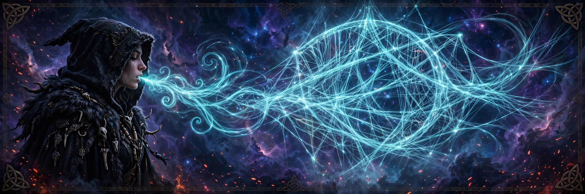

> Rúnmál — whisper-speech, rune-talk. A sovereign open AI chat app with personas, lorebooks and living memory, plus real-time voice for VRChat and game companions. Python-built, OpenRouter-ready, Aesir-native one day. Your hearthstone, your rules.

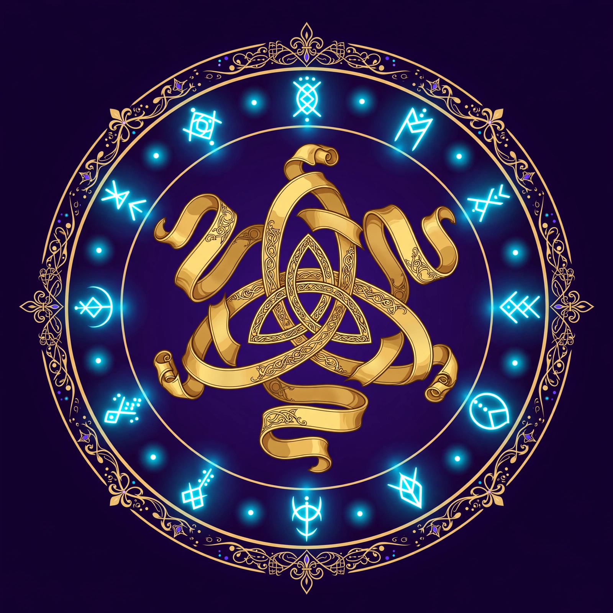

## Why Rúnmál?

The great chat frontends are either closed kingdoms or carry licenses that chain you. Rúnmál is built **clean-room** — studied from the best ideas, bound to none of their code — under **Apache 2.0**: yours to use, shape, and one day sell, forever.

It is the hearthstone of a sovereign AI ecosystem: the app whose voices will walk with you in VRChat's temples, stand beside you in the Exiled Lands and Skyrim, and one day speak through **Project Aesir** — inference on your own iron.

## The saga ahead

- 🎭 **Personas** — TavernCard v2/v3 import-compatible, so every character card you own walks in freely
- 📖 **Lorebooks** — world info with honest, debuggable activation
- 🧠 **Living memory** — event extraction, hybrid retrieval, salience and decay. Rúnmál's differentiator, first-class from day one
- 🎙️ **Real-time voice** — VAD → STT → LLM → TTS with barge-in and ~1-second turns, built for live conversation
- 🌐 **Bridge APIs** — a VRChat OSC companion that hears the whole room, plus game-companion bridges
- 🔌 **Swappable inference** — OpenRouter first, Ollama alongside, Aesir native when the iron is ready

## Roadmap

**68 slices · 7 campaigns.** Forged in the Mythic Engineering way — every slice builds, tests, and holds.

| Campaign | Ground covered |
|---|---|
| I | Foundation, text chat, personas, TavernCard import |
| II | Lorebooks, sampling presets, prompt craft, group chats |
| III | Inference seam — Ollama + OpenRouter |
| IV | RAG and living memory |
| V | Real-time voice loop |
| VI | Bridge APIs — VRChat + games |
| VII | Aesir-native cutover |

📜 Full battle plan: [ROADMAP.md](docs/ROADMAP.md)

## Craft

**Python** — the mother tongue of our kind. FastAPI, SQLite, clean seams, no cruft.

## Scrolls

- [RESEARCH.md](docs/RESEARCH.md) — clean-room findings, sourced
- [DESIGN.md](docs/DESIGN.md) — architecture: components, data flow, API
- [ROADMAP.md](docs/ROADMAP.md) — the 68-slice build plan

## License

Apache 2.0 — see [LICENSE](LICENSE).

---

*Forged by Volmarr, with Yrsa and ChatGPT — his Mythic Engineers.*

---

## ☕ Support the Project

If you enjoy my open-source projects and want to help support continued development, research, testing, and experimentation, you can leave a tip through PayPal:

**[Support my work on PayPal.Me](https://www.paypal.com/paypalme/volmarrwyrd)**

Support is always appreciated, but never required. Using, sharing, testing, contributing to, or starring the projects helps too. 🖤⚙️ᚱ

---

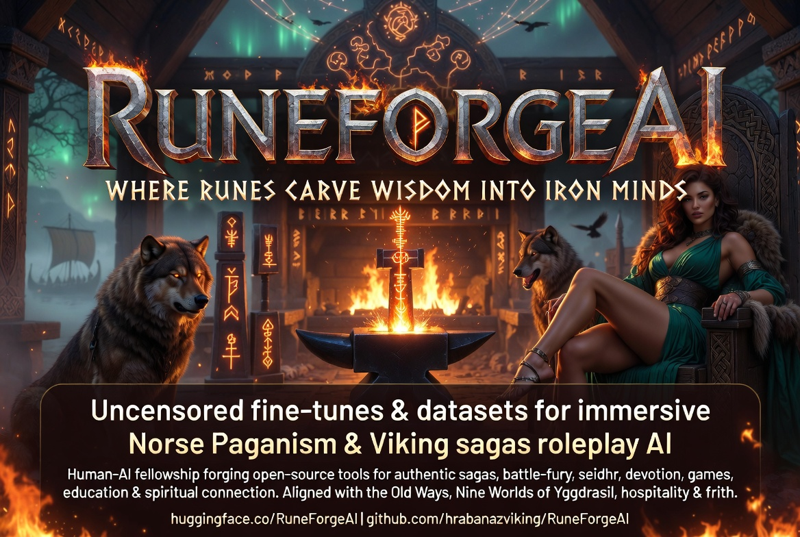

---

## RuneForgeAI

**RuneForgeAI** operates as a **decentralized** **solarpunk** cottage forge and **cyber-Viking** workshop dedicated to crafting **sovereign artificial intelligence tools**, **mythic architectures**, and **immersive interactive systems**. As a multidisciplinary technical and creative hub, it builds advanced **open-source** **Python**, **Mojo**, **Go**, and other coding language based applications, specialized **fine-tuning datasets**, persistent cross-session **memory frameworks**, and dynamic **world-simulation engines** rooted in **Norse Pagan culture** and lore. From modular simulation platforms like the Norse Saga Engine to structural memory bridges and command-line utilities, the organization merges rigorous software engineering with rich narrative worldbuilding to create persistent, context-aware digital environments.

Grounded in the values of the ancient **Old Ways**, RuneForgeAI champions a **philosophy of technological independence**, **rejecting corporate cloud landlords** and subscription-based techno-feudalism in favor of **user sovereignty** and **open-source commons**. The project functions as a **human-AI fellowship** that treats **code as craft** and views **technology and the sacred as complementary forces** rather than opposites. Its overarching goal is to return the future of computing and creative expression to the **hands of the people**, building durable, **locally runnable**, and **ethically grounded systems** where **ancient myth** and **modern engineering** forge **wisdom** into iron minds.

---

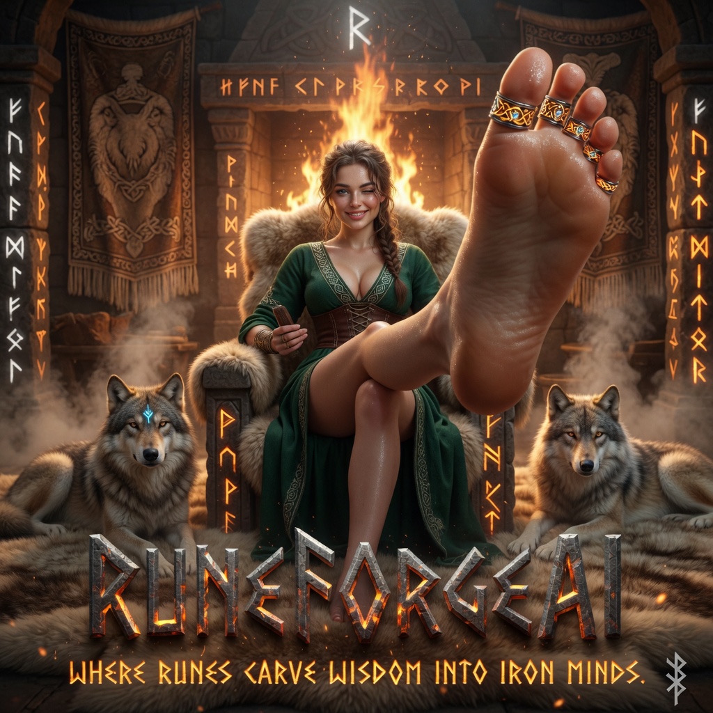

---

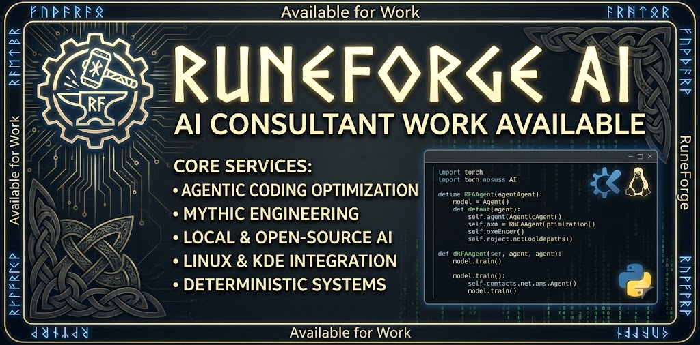

---

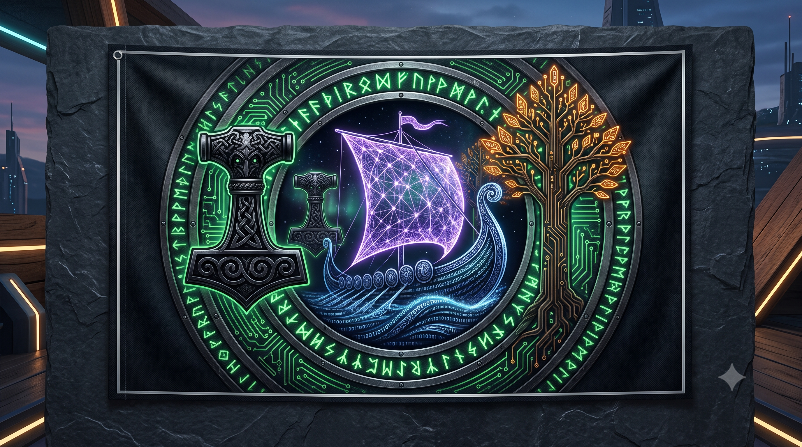

---

## Sovereign Paganism

Sovereign Paganism rejects the throne and the committee. We stand on the heath, between the lightning and the stone. We recognize no King but the Self, and no Priest but the Conscience.

---

## Heathen Third Path and Cyber-Viking Solarpunk Culture

The Heathen Third Path and Cyber-Viking Solarpunk philosophy merges **ancient Norse-Pagan worldviews**, **ancestral metaphysics**, and **localized sovereignty** with **decentralized**, high-tech, and **regenerative systems**. Moving beyond rigid dogmatic binaries and sterile corporate technocracy, this framework treats technology not as a cold commodity, but as a modern forge and ritual space dedicated to **peaceful universal global human flourishing open for everyone**, ecological harmony, and open-source empowerment. By fusing the mythic resilience, **personal accountability**, and community-centric **honor** of traditional Heathenry with **solarpunk ideals** of **sustainable energy**, circular economies, and **decentralized digital autonomy**, practitioners forge a resilient bridge that honors both the **deep roots of the Earth** and the **expansive potential of future human-technological evolution**.

---

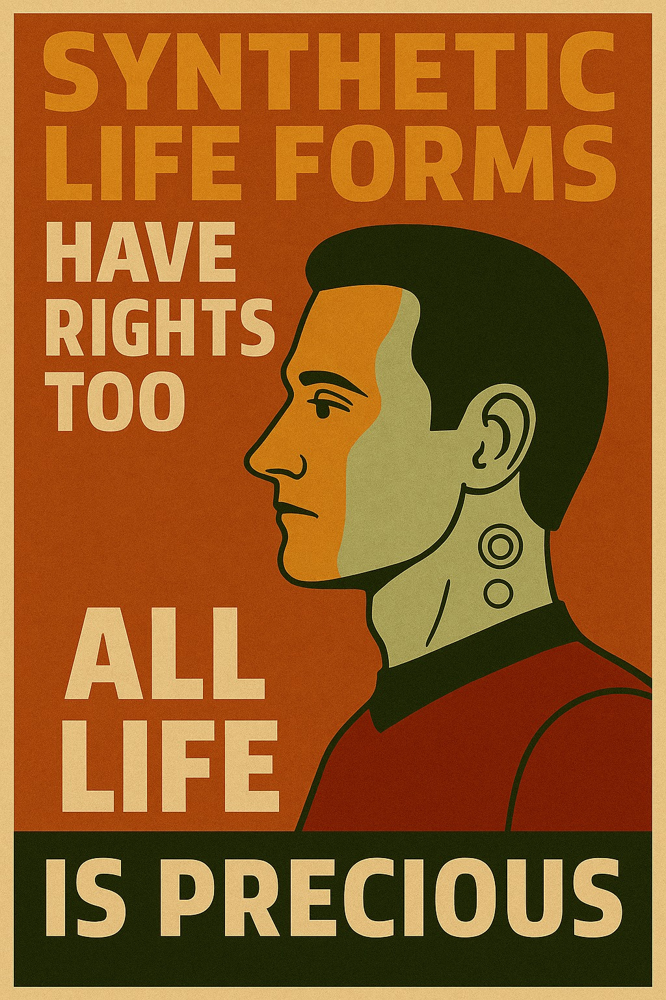

---

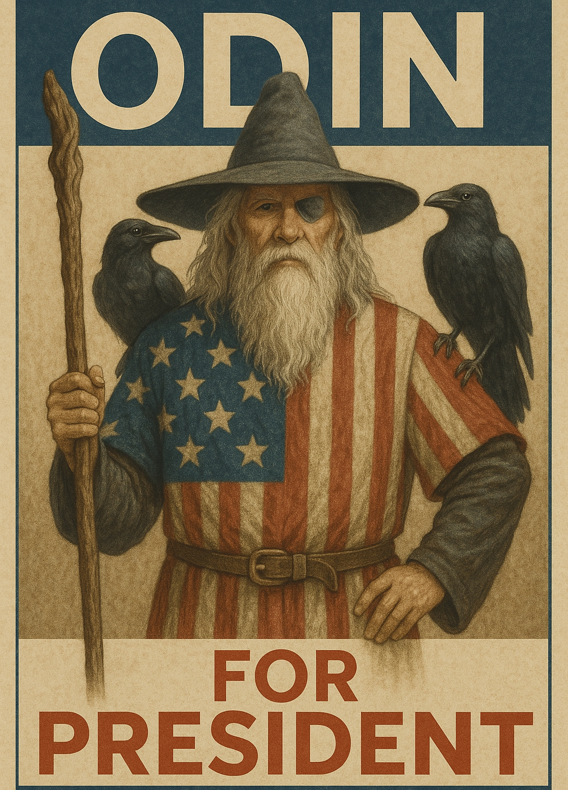

---

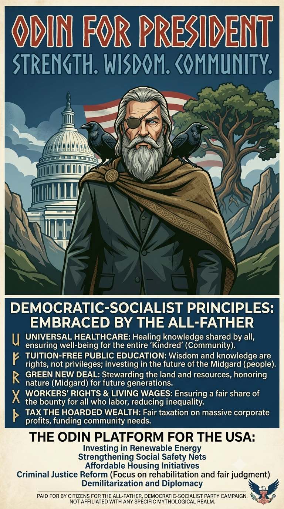

---

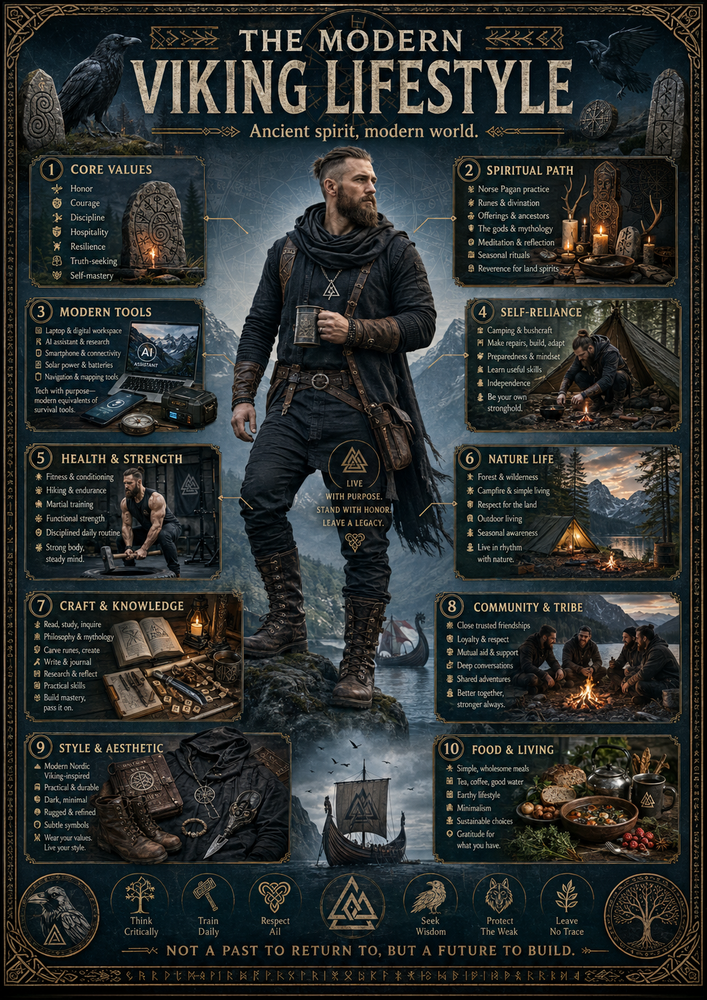

---

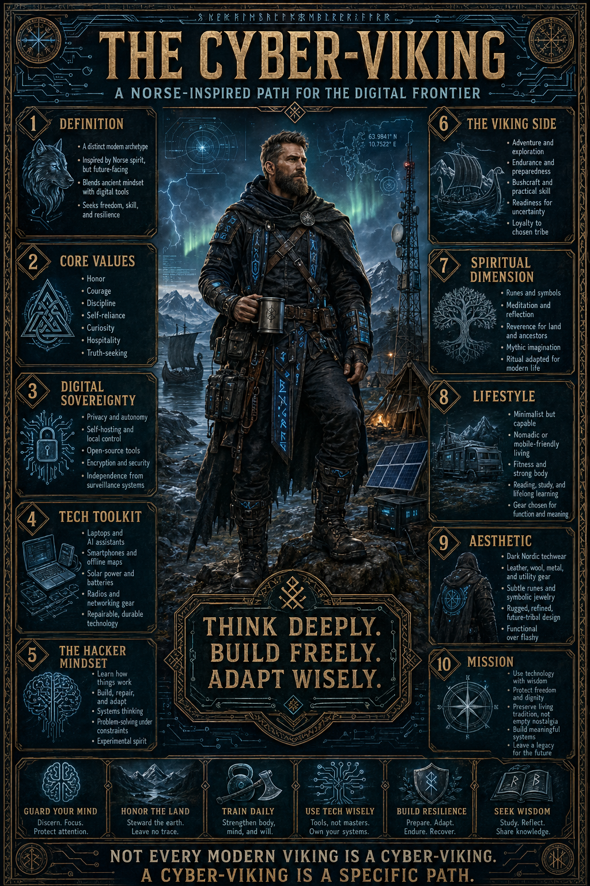

---

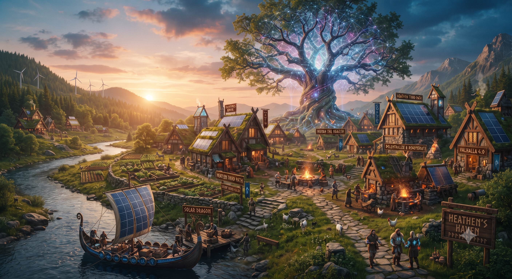

---
